# Aditya Kirtane — Developer Portfolio

**Angular Developer · Mumbai, India · 4+ years building web, mobile, and product experiences**

A responsive Angular portfolio presenting my professional experience, technical skills,
and selected projects. A skippable introduction opens into a dark, red-accented interface
with a career timeline, reusable project case studies, and motion that adapts to the
visitor’s preferences.

[**Explore the live portfolio →**](https://aditya-kirtane-portfolio.vercel.app/)
· [GitHub](https://github.com/ak-ak-k)
· [LinkedIn](https://linkedin.com/in/adityakirtane)
· [Résumé PDF](src/assets/resume/aditya-kirtane-resume.pdf)


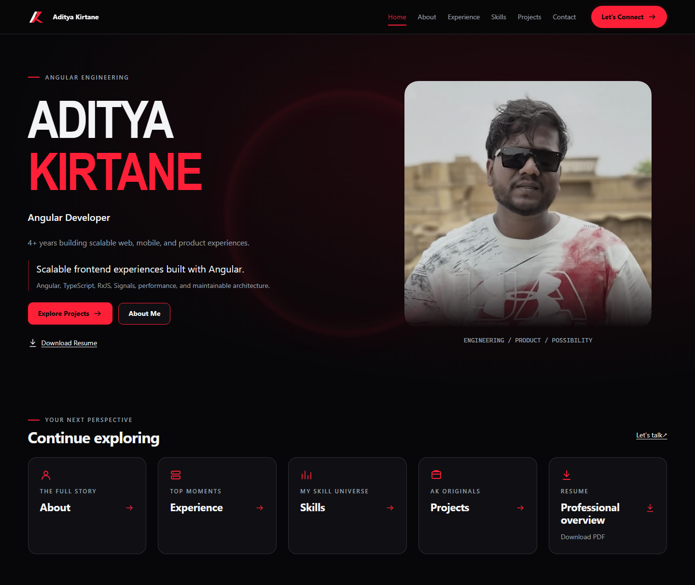

[Experience](#portfolio-experience) · [Screenshots](#screenshots) ·
[Engineering](#engineering-highlights) · [Architecture](#architecture) ·
[Projects](#project-case-studies) · [Run locally](#run-locally) · [Quality checks](#quality-checks)

## Portfolio experience

Explore each section through the primary navigation or Home launchers. Career and project
descriptions retain source notes in their typed content configuration.

| Page                                                                                                   | Experience                                                                                                                                        |
| ------------------------------------------------------------------------------------------------------ | ------------------------------------------------------------------------------------------------------------------------------------------------- |
| [Home `/`](https://aditya-kirtane-portfolio.vercel.app/)                                               | Intro → canonical Home, professional introduction, Explore Projects, About Me, résumé download, and section launchers.                            |
| [About `/about`](https://aditya-kirtane-portfolio.vercel.app/about)                                    | “The full story”: background, engineering strengths, and work across healthcare, finance, CRM, inventory, customer services, and field sales.     |
| [Experience `/experience`](https://aditya-kirtane-portfolio.vercel.app/experience)                     | “Top moments”: an ordered career timeline for Onelife Capital Advisors Limited, Refr, and The Contrast, alongside a shared-data journey overview. |
| [Skills `/skills`](https://aditya-kirtane-portfolio.vercel.app/skills)                                 | “My skill universe”: Frontend, Mobile, Backend & APIs, Database & Data, and DevOps / Tools categories, plus an Angular focus section.             |
| [Projects `/projects`](https://aditya-kirtane-portfolio.vercel.app/projects)                           | “AK Originals”: six linked entries, supported stack tags, summaries, and clearly labelled cover artwork.                                          |
| [Case studies `/projects/:slug`](https://aditya-kirtane-portfolio.vercel.app/projects/ready-inventory) | Reusable detail view with conditional technical sections, previous/next navigation, and recovery for unknown slugs.                               |
| [Contact `/contact`](https://aditya-kirtane-portfolio.vercel.app/contact)                              | Native email/phone actions, LinkedIn, location, and deliberate PDF résumé download. There is no submission backend.                               |

**Introduction.** A fresh Home load plays the portrait/brand reveal. Skip intro enters
Home immediately; automatic completion waits for the reveal and critical image checks,
with safety timeouts. Completion stays in memory for the app instance: returning Home
skips it, while refreshing replays it. Reduced motion uses a brief static introduction.
There is no profile-selection step. See [the current startup contract](docs/home-cleanup.md).

**Responsive navigation.** Desktop exposes section links and an active-page underline.
Below 64rem, a button controls the expanding menu with `aria-expanded`; Escape closes it
and returns focus. Successful navigation closes the menu and focuses the destination
heading. Layouts stack on smaller screens; the desktop career overview enters normal
document flow on tablet/mobile.

## Screenshots

Captured with Playwright from the **local production build**, using 1440 × 900 desktop
and 390 × 844 mobile viewports, normal motion, and actual supplied assets. Content pages
use full-page captures so sections remain complete; Intro and the open menu use the viewport.
These show the portfolio itself; artwork inside project cards is **not a screenshot of
the external product**. See [capture details and inventory](docs/github-showcase.md).

<details>
<summary>Explore the desktop gallery</summary>

**Introduction**

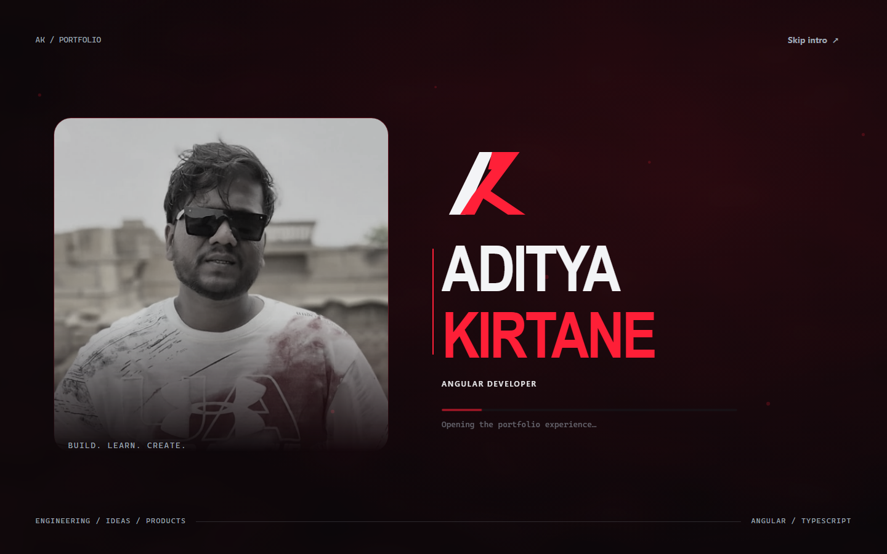

**About**

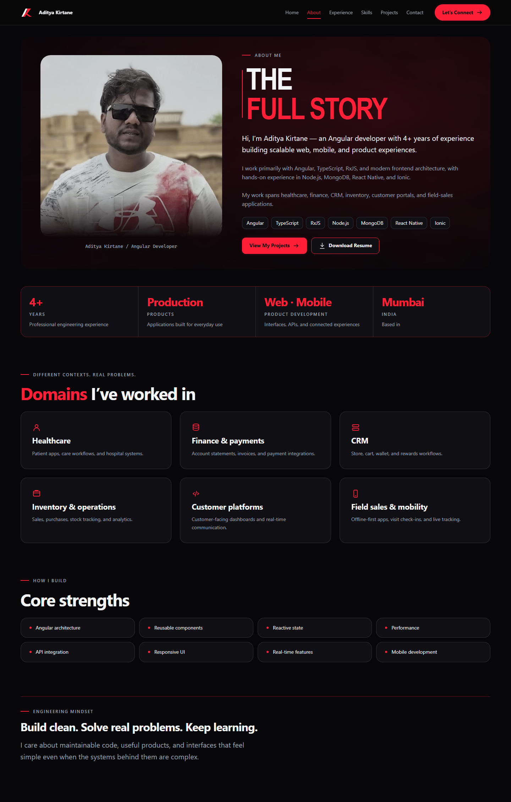

**Professional experience**

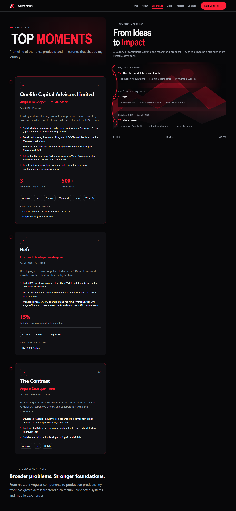

**Technical skills**

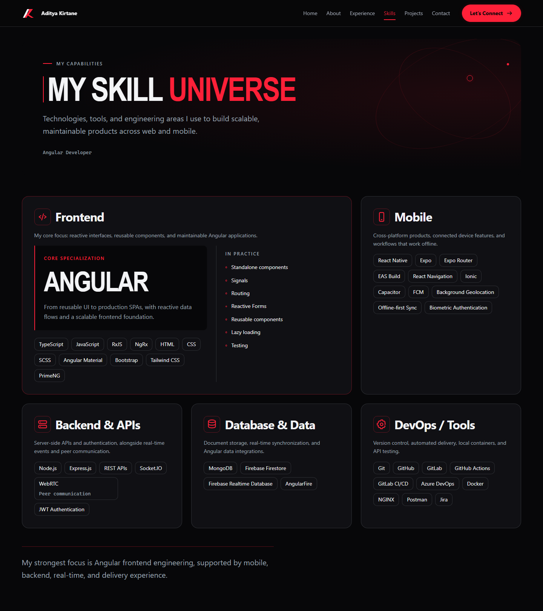

**Project showcase**

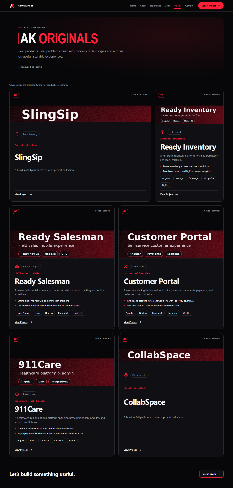

**Reusable case study**

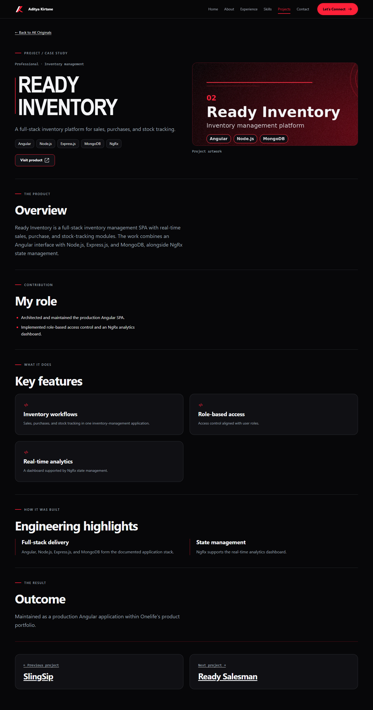

**Contact**

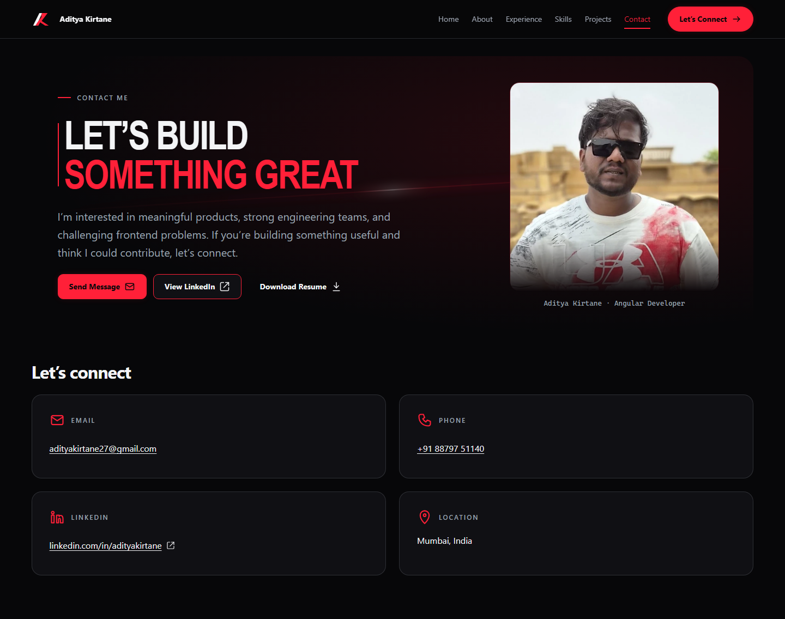

</details>

<details>
<summary>Explore the mobile gallery</summary>

**Home**

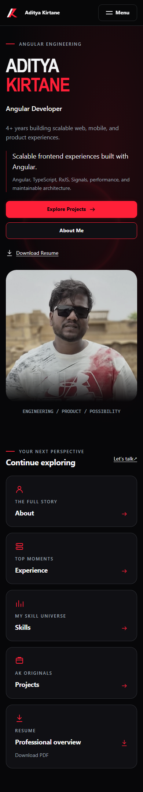

**Navigation**

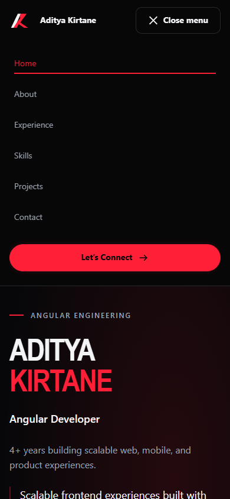

**Projects**

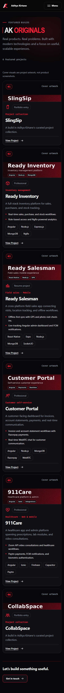

**Case study**

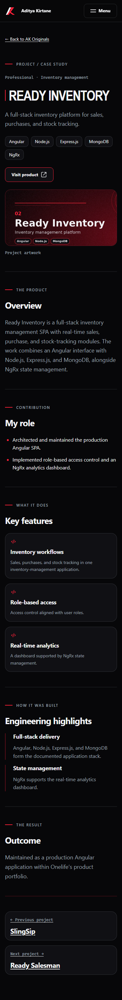

**Contact**

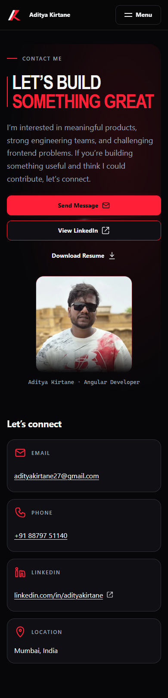

</details>

## Technology stack

Versions come from the committed `package-lock.json`, rather than the broader manifest ranges.

| Layer                | Implementation                                                                                |
| -------------------- | --------------------------------------------------------------------------------------------- |
| Application          | Angular **22.2.2**, standalone components, Signals/`computed()`, native template control flow |
| Language             | TypeScript **6.0.3**, strict application/templates, unused-code checks                        |
| Navigation           | Angular Router **22.2.2**, lazy features, titles, signal input binding, scroll restoration    |
| Styling              | Component SCSS, shared utilities, primitive CSS tokens and semantic SCSS tokens               |
| Motion               | GSAP **3.15.0**, ScrollTrigger, scoped contexts; optional Flip loader in the infrastructure   |
| Reactive integration | RxJS **7.8.2** for Router subscriptions and Angular lifecycle interop                         |
| Build                | Angular CLI/build **22.2.2**, hashed bundles, explicit asset patterns and budgets             |
| Unit testing         | Angular unit-test builder, Vitest **4.1.11**, jsdom **28.1.0**                                |

This is a browser-rendered frontend with local typed content and static assets.
Node.js runs development/build tools. MongoDB, Electron, Ionic, and NgRx belong to the
professional/project content where documented, not to this portfolio’s runtime architecture.

## Engineering highlights

- **Feature boundaries and lazy routes.** Each primary page uses `loadComponent`;
  Projects adds lazy route configuration. The shell owns navigation, cursor, destination
  focus, and transitions. See [routes](src/app/app.routes.ts) and [app configuration](src/app/app.config.ts).
- **URL-owned project selection.** The root `UiState` service derives section and slug
  from Router state. Intro/menu/cursor signals expose read-only state and explicit
  actions. A required slug input and computed lookup drive the detail page.
  See [UI state](src/app/core/services/ui-state.ts) and [ProjectDetail](src/app/features/projects/project-detail/project-detail.ts).
- **Motion with ownership.** `createMotionContext` uses scoped GSAP `matchMedia`.
  Cleanup reverts only owned animations/ScrollTriggers. Detail effects also clean up
  when the Router reuses the component for a new slug. Base styles remain readable with
  reduced motion. See [motion utilities](src/app/animations/create-motion-context.ts).
- **Nonblocking transitions.** A lazy animator responds to Router events; generation
  checks reject stale imports, cancellation clears work, and a watchdog prevents lingering
  decoration. The pointer-transparent overlay is bypassed for reduced motion/forced colors.
  See [transition lifecycle](docs/route-transitions.md).
- **Progressive cursor enhancement.** Eligible large-screen fine pointers load tracking
  on demand. Tracking runs outside Angular without per-move signal writes; the native
  cursor remains available. Touch, keyboard, reduced motion, and forced colors have
  fallback behavior. See [cursor implementation](src/app/layout/cursor/cursor.ts).
- **Deliberate assets and budgets.** `NgOptimizedImage` reserves image space, the approved
  headshot is reused, leading covers receive priority, and other covers load lazily.
  Production excludes reference mockups, source portraits, and the duplicate résumé.
  Budgets remain 500 kB warning / 1 MB error for initial bundles and 4 / 8 kB for
  component styles. See [build configuration](angular.json).
- **Accessible interactions.** Semantic landmarks, one main H1, skip navigation,
  destination focus, `aria-current`, native actions, visible focus, reduced-motion
  styles, and system-color fallbacks support keyboard and preference-aware use.
  Automated checks are scoped evidence, not complete WCAG certification.
- **Maintainable visual language.** [Primitive tokens](src/assets/tokens/design-tokens.css)
  feed [semantic tokens](src/styles/_tokens.scss) and shared utilities. Typed, readonly
  feature data separates source-attributed content from presentation.

## Architecture

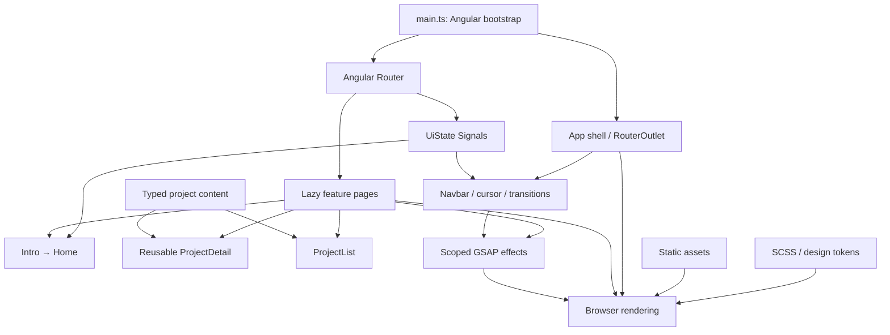

Content is bundled locally; no portfolio API, database, authentication, or SSR layer is
configured. [Architecture notes](docs/architecture.md) explain ownership, lazy boundaries,
styling, and the separate transition lifecycle.

## Project case studies

The [typed catalog](src/app/features/projects/projects.config.ts) supplies six names,
summaries, assets, and stable routes. The [case-study configuration](src/app/features/projects/project-detail/project-detail.config.ts)
adds supported sections: overview, contribution, features, engineering, component map,
outcome, metrics, and external links. Empty optional sections are omitted.

| Project                                                                                 | Current portfolio content                                                                                                                                                                                                      |
| --------------------------------------------------------------------------------------- | ------------------------------------------------------------------------------------------------------------------------------------------------------------------------------------------------------------------------------ |
| [SlingSip](https://aditya-kirtane-portfolio.vercel.app/projects/slingsip)               | Short collection entry. Its [public repository](https://github.com/ak-ak-k/SlingSip) now documents an Angular/Electron hydration companion; that external evidence has not been incorporated into the existing portfolio page. |
| [Ready Inventory](https://aditya-kirtane-portfolio.vercel.app/projects/ready-inventory) | Résumé-backed inventory workflows, role-based access, and NgRx analytics; Angular / Node.js / Express / MongoDB.                                                                                                               |
| [Ready Salesman](https://aditya-kirtane-portfolio.vercel.app/projects/ready-salesman)   | Résumé-backed field-sales app, offline sync, GPS/photo check-ins, and Angular tracking dashboard; no employer attribution added.                                                                                               |
| [Customer Portal](https://aditya-kirtane-portfolio.vercel.app/projects/customer-portal) | Résumé-backed invoices, statements, payments, WebRTC, and attributed table-rendering optimization.                                                                                                                             |
| [911Care](https://aditya-kirtane-portfolio.vercel.app/projects/911care)                 | Résumé-backed healthcare app/admin, consultations, payments, notifications, and mobile integrations.                                                                                                                           |
| [CollabSpace](https://aditya-kirtane-portfolio.vercel.app/projects/collabspace)         | Short collection entry; implementation details remain unverified.                                                                                                                                                              |

Current covers are supplied **artwork**. There are no genuine screenshots of the external
applications in this repository. Implemented product links come from the published résumé;
their availability is independent of this portfolio.
See [the current evidence review](docs/project-evidence.md) and [case-study guide](docs/project-details.md).

## Run locally

Use Node accepted by the locked Angular CLI:
**`^22.22.3 || ^24.15.0 || >=26.0.0`**. This review used **Node 24.19.0** and
**npm 11.9.0** on Windows. The manifest declares `npm@11.19.0`; earlier documented
QA used Node 24.21.0 / npm 11.19.0.

```bash
git clone https://github.com/ak-ak-k/aditya-kirtane-portfolio.git
cd aditya-kirtane-portfolio
npm ci
npm start
```

Open `http://localhost:4200/`. The development-only `/design-system` previews shared
styles/components; a route file replacement excludes it from production.

| Task                                  | Command                                                          |
| ------------------------------------- | ---------------------------------------------------------------- |
| Development server                    | `npm start`                                                      |
| Production build                      | `npm run build`                                                  |
| Strict application/test type checking | `npm run typecheck`                                              |
| Unit tests, one run                   | `npm run test:ci`                                                |
| Unit tests, watch mode                | `npm test`                                                       |
| Preview the built static site         | `node scripts/preview-production.mjs` → `http://127.0.0.1:4300/` |

Build before running the preview. It serves real assets with SPA fallback for application
URLs. [Capture instructions](docs/github-showcase.md#reproduce-the-captures) keep browser
tooling isolated from application dependencies.

## Quality checks

Current review: **20 October 2026**, local commit `4ffba23` plus documentation/tooling changes.

| Check               | Current result                                                                                                                                                                                                                                                                 |
| ------------------- | ------------------------------------------------------------------------------------------------------------------------------------------------------------------------------------------------------------------------------------------------------------------------------ |
| `npm run build`     | Passed without budget warnings; initial bundles **278.67 kB**, estimated transfer **77.14 kB**. These are build estimates, not user performance measurements.                                                                                                                  |
| `npm run typecheck` | Passed for application and test configurations.                                                                                                                                                                                                                                |
| `npm run test:ci`   | **Failed on both runs.** Latest: 143 passed, 3 failed, 7 skipped among 153 collected tests; 6 files failed / 18 passed. GSAP registration encounters missing `window.matchMedia` in jsdom. See the linked verification record for both runs; no tests were changed or removed. |
| Playwright / axe    | Passed 65 recorded browser checks and 45 axe audits with zero violations. Contrast review flags remain; see [scope and limitations](docs/github-showcase.md#current-verification).                                                                                             |

[Final QA](docs/final-qa.md), [startup cleanup](docs/home-cleanup.md),
[experience redesign](docs/experience-redesign.md), and [project numbering](docs/projects.md)
retain historical results. Their passing totals describe dated runs and do not replace
the current unit failure. No Lighthouse score or blanket accessibility/performance
certification is claimed.

## Project structure

```text
src/
  app/
    animations/     GSAP registration, scoped motion helper, optional Flip loader
    core/           Identity, route/UI models, Signals state service
    features/       Home/Intro, About, Experience, Skills, Projects/details, Contact
    layout/         Navbar, optional cursor, global route transition
    development/    Development-only design-system route
    shared/         Reserved directives, pipes, utilities (currently placeholders)
  assets/           Portraits, artwork, branding, icons, résumé, primitive tokens
  styles/           Semantic tokens, typography, layout, controls, accessibility
docs/               Feature guides, architecture, dated QA, real screenshots
scripts/            Local preview, screenshot/smoke checks, README verification
public/             Root assets (production copy explicitly filtered)
```

## Deployment

The [live portfolio](https://aditya-kirtane-portfolio.vercel.app/) and representative
direct deep links loaded successfully in headless Edge on 20 October 2026. GitHub’s
[repository About panel](https://github.com/ak-ak-k/aditya-kirtane-portfolio) advertises
this Vercel URL. Hosting configuration/automation is absent from this checkout;
the deployed commit was not established.

For a future manual static deployment, publish **`dist/ak-portfolio/browser/`** after
`npm run build`. The app assumes `/` as its base. Use HTTPS, serve real files normally,
rewrite application routes to `index.html`, and return 404 for missing assets.
Enable compression; cache hashed JS/CSS immutably, revalidate `index.html`, and version
or conservatively cache unhashed assets. SSR is disabled; absolute canonical/social
metadata is a separate follow-up. This documentation work does not deploy anything.

## Technical documentation

| Start here                                          | Deeper references                                                                                                  |
| --------------------------------------------------- | ------------------------------------------------------------------------------------------------------------------ |
| [Architecture and ownership](docs/architecture.md)  | [Foundation](docs/foundation.md), [design system](docs/design-system.md), [transitions](docs/route-transitions.md) |
| [Current startup](docs/home-cleanup.md)             | [Intro](docs/intro.md), [Home](docs/home.md), [About](docs/about.md)                                               |
| [Experience](docs/experience.md)                    | [Journey redesign](docs/experience-redesign.md), [skills](docs/skills.md)                                          |
| [Project evidence](docs/project-evidence.md)        | [Showcase](docs/projects.md), [case studies](docs/project-details.md), [Contact](docs/contact.md)                  |
| [Showcase QA and captures](docs/github-showcase.md) | [Historical final QA](docs/final-qa.md)                                                                            |

Older guides preserve implementation history. Dated profile-selector references are
superseded by the current Intro → Home contract.

## Author

Built by **[Aditya Kirtane](https://github.com/ak-ak-k)** — Angular Developer.
Explore [professional background](https://aditya-kirtane-portfolio.vercel.app/about),
[selected work](https://aditya-kirtane-portfolio.vercel.app/projects), or
[get in touch](https://aditya-kirtane-portfolio.vercel.app/contact).
