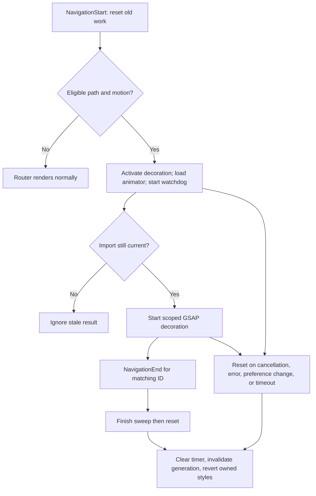

# Portfolio architecture

Source review: 20 October 2026, commit `4ffba23`. This is the current architecture;
the step guides retain historical implementation details. No application architecture
was changed for the GitHub showcase.

## Entry, routing, and state

[`main.ts`](../src/main.ts) uses `bootstrapApplication` with
[`app.config.ts`](../src/app/app.config.ts). The browser-only build has no server entry,
HTTP content service, persistence, authentication, or backend. Angular components use
standalone defaults and native template control flow. Strict TypeScript and strict
Angular template checking are enabled in [`tsconfig.json`](../tsconfig.json).

[`app.routes.ts`](../src/app/app.routes.ts) lazy-loads each feature. Projects loads
[`projects.routes.ts`](../src/app/features/projects/projects.routes.ts), then its list
or detail component. Component input binding supplies the detail slug. Titles use
verified identity/catalog data. Unknown application paths redirect Home; an unknown
project slug renders its own recovery page. Scroll and anchor restoration are configured
at Router setup. No route preloading strategy is configured.

[`UiState`](../src/app/core/services/ui-state.ts) is a root `@Service()` using `inject()`.
Private signals own intro completion, menu state, and cursor mode. A Router snapshot
signal drives computed active section and selected project. Consumers receive read-only
signals and call explicit actions. `NavigationEnd` synchronizes the snapshot, closes
the menu, and resets cursor mode; `takeUntilDestroyed` owns subscription cleanup.
The URL owns project selection; there is no duplicate selected-project store.

Home switches between Intro and HomeLanding using the in-memory completion signal.
There is no local/session storage and no profile selector. Refresh resets completion.
The shell mounts navbar/cursor after Intro, scrolls to the top on the internal handoff,
and focuses the new H1. See [current startup](home-cleanup.md).

## Shell and accessibility

[`App`](../src/app/app.ts) owns semantic header/main, RouterOutlet, the skip link,
destination H1 focus, and global decoration. The navbar owns its scroll signal and
media/listener cleanup; `UiState` owns menu state. Active links use `aria-current`.
Escape restores focus to the menu button; leaving the navbar or navigating closes
the menu. Informational content uses native headings/lists/articles rather than
nonfunctional controls.

[`_accessibility.scss`](../src/styles/_accessibility.scss) supplies visible focus,
skip navigation, reduced CSS motion, and forced-color treatment.
[`_tokens.scss`](../src/styles/_tokens.scss) maps semantic colors to system colors
under forced colors. These are implementation decisions; the current browser audit
scope and limitations are recorded in [showcase QA](github-showcase.md).

## Motion ownership

Feature effect injection tokens isolate browser/GSAP work from component tests.
After rendering, features create scoped motion through
[`createMotionContext`](../src/app/animations/create-motion-context.ts). GSAP
`matchMedia` runs animation only for `prefers-reduced-motion: no-preference` and reverts
it if the preference changes. Components register cleanup with `DestroyRef`, while
ProjectDetail uses `afterRenderEffect(onCleanup)` so a reused component also cleans
up between slugs. Cleanup is local; it does not globally kill another feature’s triggers.

[`gsap.ts`](../src/app/animations/gsap.ts) registers ScrollTrigger and exposes an
optional dynamic Flip loader. The loader exists as infrastructure; the current product
does not depend on Flip for its Intro → Home handoff. Feature reveals mainly animate
opacity and transforms; Experience also reveals the inline SVG journey path once.
Base styles expose complete content when feature motion is skipped.

Cursor tracking is dynamically imported only for an eligible large-screen fine pointer
with normal motion. Pointer tracking runs outside Angular without per-move Signals
writes. It preserves the native pointer and cleans up on preference changes, keyboard
use, and destruction. See [Home/cursor details](home.md).

## Route-transition lifecycle

The Router never waits for animation. A navigation may complete while the lazy animator
is loading; the component remembers the settling phase and finishes after import.
First loads, same-path changes, internal Intro handoff, development preview, reduced
motion, and forced colors bypass the sweep. A 1.5-second watchdog clears lingering
decoration. The fixed overlay is `aria-hidden` and pointer-transparent, so it owns
neither focus nor input. See [the complete transition guide](route-transitions.md).

## Content and assets

Readonly, typed `*.config.ts` files own professional content and source notes.
[`projects.config.ts`](../src/app/features/projects/projects.config.ts) owns the six
closed slugs, summaries, paths, and order. The detail configuration adds optional
sections; `getProjectDetail` joins summary/study/previous/next. There is one reusable
detail template, with no separate component per project. Its technical descriptions
are about those projects, not services running inside this portfolio.

Primitive values in [`design-tokens.css`](../src/assets/tokens/design-tokens.css)
feed semantic tokens and shared SCSS. Components use relative template/style paths.
The `shared/` subdirectories currently reserve space; the working reusable shell,
motion utilities, and journey component live with their owning concerns.

`NgOptimizedImage` reserves image frames; the approved headshot is reused by identity
pages. Covers are supplied artwork, with verified crop/disclosure rules. The first
two catalog covers and each detail hero receive priority; other catalog covers use
native lazy loading. The résumé is downloaded only by deliberate native actions.

Production [`angular.json`](../angular.json) copies an explicit asset subset,
excluding reference mockups, source portraits, and duplicate résumé data. It applies
hashed bundles and unchanged initial/component-style budgets. Development replaces
the empty development route configuration with the `/design-system` route; production
does not import that preview. No external fonts, videos, or autoplay media are used.

## Boundaries of current evidence

Lazy chunks and budget success are verified by the current production build. This
does not establish real-user performance; earlier cold-mobile case-study LCP findings
remain historical observations. The browser gallery is local production output, while
live-site checks are separate and do not establish the deployed commit. The unit suite
currently fails during some GSAP/jsdom imports. See [executed QA](github-showcase.md).
